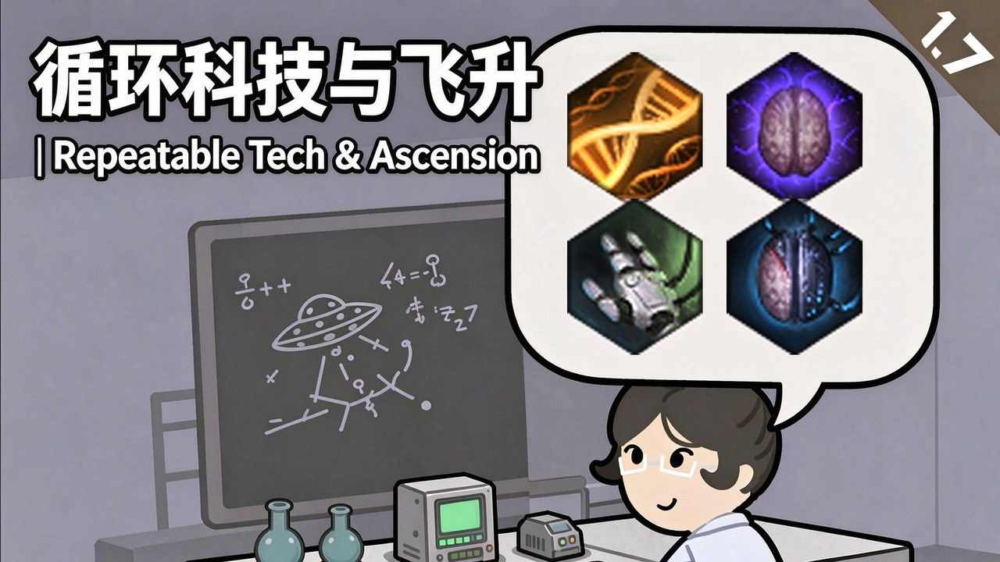

# 循环科技 · Research Loops



把《群星》的循环科技搬进环世界。29 项关键科技各成一条可反复研究的循环链，研究完一级原地升下一级，成本与收益一起上涨、效果永久叠加；后期研究台不再闲置。

- 当前版本：v1.2（2026-11-06）
- 支持版本：RimWorld 1.6 / 1.7；1.8 / 1.9 / 2.0 为提前占位声明（尚未实测）
- 前置依赖：[Harmony](https://steamcommunity.com/sharedfiles/filedetails/?id=2009463077)
- 创意工坊：https://steamcommunity.com/sharedfiles/filedetails/?id=3830009762
- 完整功能与数值：[INTRO.md](INTRO.md)
- 版本历史：[CHANGELOG.md](CHANGELOG.md)
- 素材授权：[docs/ASSET-LICENSE.md](docs/ASSET-LICENSE.md)

---

## 中文介绍

群星小伙天然气成瘾，每天爽吃能量币，需要专门的研究所，只会按部就班研究科技，能量微小；环世界小伙每天 吃了营养膏-4 在地上吃饭-3 可怕的多人宿舍-7 极其丑陋的环境-15，能够只靠翻动研究台上的几张纸研究出科技，能量巨大。环世界虽然已经凭借着先进的希望工程，奴隶制和掏心掏肺战胜了群星落后的极致时代科技，但是因为质子封锁却始终未能开始跑循环，所以我（和d指导）完成了这个mod，让和我一样文化：科研：非常快，研究速度：200%，研究速度系数：189%的玩家后期有事干。

本模组内容包含涵盖各个方面的科技循环，并且有四种物种飞升以及最后的化身天灾（饼，没想好效果），物种飞升前置条件为多种循环跑满，化身天灾则在全部物种飞升结束之后出现，物种飞升≈半步~，化身天灾≈~全开，效果无法消除，请谨慎考虑。

什么，你问我这个科技是哪里来的？emm，可以是知管扔的，帝国用来发现洞见的（依旧落后的银河帝国需要学习先进的土著），虚境来的，小灰v的，或者超凡智能天意发力了。

Tips：本模组偏正义，科技循环不计入财富值，想要更好的平衡可以选择下调效果，上调所需点数或者关闭物种飞升。

### Q&A

**Q：语言？**  
A：中文和机翻的English

**Q：前置需求？**  
A：灵能部分要求皇权dlc，机械体要求生物科技dlc，没有也没关系

**Q：包含哪些循环？**  
A：技能等级，通用劳作速度，物品品质，技能兴趣，远程伤害，近战伤害，承受伤害，护甲值，闪避率，近战命中率，硬直时间，远程后摇，蓄力时间，近战后摇，移动速度，射击失误率，部位血量，疼痛抵抗，流血速度，休息效率，疲劳衰减，娱乐衰减，饥饿衰减，冥想速率，灵能敏感度，灵能熵上限，灵能熵恢复，机械带宽，机械能耗，每个循环跑满165,625点

**Q：物种飞升包含什么？**  
A：群星四大飞升，每完成一个常驻+15心情（前置科技只要求10级，每个1w点）：

- 心胜于物（灵能飞升）：灵能技能不消耗精神力；心灵熵停止累积；告别冥想（配合灵能拓展更佳）
- 合成进化（机械飞升）：机械师指挥无距离限制；机械体也能吃「循环科技」；身体部位缺损不再影响任何能力，控制机械体不消耗带宽并且机械体不需要充电
- 血肉苦弱（义体飞升）：不再流血、不再感到疼痛、娱乐／休息／饥饿值不再下降；伤口不留疤痕；护甲值固定为满（现在可以随便穿美美的衣服了）
- 设计进化（基因飞升）：全部身体能力 +100%；伤口自愈速度 ×50；免疫速度 ×50；远程必定命中（机枪、榴弹等强制散布武器除外）

**Q：中途加入或移除？**  
A：YES

**Q：性能占用？**  
A：约为零，加载耗时小于5ms

**Q：兼容性？**  
A：尝试了ve全家桶，1k+mod，鼠猫米螈龙娘沃芬雪豹，目前一切良好

**Q：强度如何？**  
A：五只跑满承伤系数和灵能飞升的鼠鼠拿dps20左右的武器借过了*10倍率的精英化袭击的闪毁全家桶：）

**Q：如何快速启动？**  
A：循环优先承伤系数，移动速度，部位血量，物品品质；飞升优先基因飞升；

**Q：敌人会使用吗？**  
A：飞升太阴了，直接ban了

**Q：是否使用AI？**  
A：3A大作，震撼人心：）

Steam：https://steamcommunity.com/sharedfiles/filedetails/?id=3830009762  
GitHub Releases：[../../releases](../../releases)

请多多批评指正，您的反馈是我成长的最佳动力：）

我说我已启动，我已启

---

## English

Stellaris researchers are gas addicts by nature — they wolf down energy credits all day, need a dedicated research institute, and still only grind out techs one at a time. Output: negligible. RimWorld colonists, meanwhile: nutrient paste (−4), eating on the floor (−3), a horrifying shared barracks (−7), a room so ugly it's −15 — and they can still pull a full tech out of a few sheets of paper on a research bench. Output: colossal. True, RimWorld already beat Stellaris' hopelessly dated "peak-era" tech with its advanced Project Hope, its slavery and its heart-and-lung harvesting — but the proton blockade kept it from ever starting a loop. So I built this mod (with DeepSeek looking over my shoulder), so that players like me — culture: research: very fast; research speed: 200%; research speed factor: 189% — have something to do in the late game.

This mod adds research loops covering nearly every corner of the game, four species ascensions, and a final Become the Cataclysm (pie in the sky for now — effects still undesigned). Ascensions require several loops maxed out; the Cataclysm only appears after all four ascensions are finished. An ascension ≈ cheats half-on. The Cataclysm ≈ cheats fully on. The effects cannot be removed once applied, so think it through first.

Huh, you're asking where this tech comes from? Emm — the Curator dropped it, or the Empire farmed it for Insights (a hopelessly backward galactic empire has to take notes from its advanced primitives), or it leaked out of the Shroud, or the little greys handed it over, or the god-mind simply decided to flex.

Tips: this mod is good-aligned. Research loops don't count toward colony wealth. For a tighter balance, dial the effects down, dial the point costs up, or switch ascensions off.

### Q&A

**Q: Languages?**  
A: Chinese, and machine-translated English.

**Q: Requirements?**  
A: The psychic side wants Royalty, the mechanoid side wants Biotech — run without them and nothing breaks.

**Q: Which loops?**  
A: skill level, general labor speed, item quality, skill passion, ranged damage, melee damage, damage taken, armor, evasion, melee hit chance, stagger duration, ranged cooldown, aiming time, melee cooldown, move speed, miss chance, body-part HP, pain resistance, bleed rate, rest effectiveness, rest drain, joy drain, hunger drain, meditation rate, psychic sensitivity, psychic entropy maximum, psychic entropy recovery, mechbandwidth, mech energy usage — every loop tops out at 165,625 points.

**Q: What do the species ascensions give?**  
A: Stellaris' four ascensions. Each one you finish is a permanent +15 mood (the prerequisite loops only ask for level 10, and each ascension costs 10k points):

- **Mind Over Matter (psychic):** psycasts stop costing psyfocus; mental entropy stops climbing; say goodbye to meditating (even better alongside a psychic-expansion mod).
- **Synthetic Evolution (mechanoid):** mechanitors command at any range; mechs can feed on Research Loops too; missing body parts no longer degrade any capability; controlling a mech costs no bandwidth and mechs never need charging.
- **The Flesh Is Weak (cybernetic):** no bleeding, no pain, and joy / rest / food never tick down; wounds leave no scars; armor is pinned at max — you can finally dress your colonists in whatever looks good.
- **Design Evolution (genetic):** every physical capacity +100%; natural healing ×50; immune response ×50; ranged shots always hit (forced-spread weapons like machine guns and grenades excluded).

**Q: Add or remove mid-run?**  
A: YES.

**Q: Performance cost?**  
A: Essentially zero, under 5 ms of load time.

**Q: Compatibility?**  
A: Tried the full VE suite, a 1,000+ mod list, and the rat / cat / newt / dragon-girl / wolfen / snow-leopard races on top of it — all fine so far.

**Q: How strong is it?**  
A: Five rat-folk with damage taken maxed and Psychic Ascension up, carrying ~20 DPS weapons, strolled straight through the entire Glitterworld Annihilator package at a ×10 elite raid multiplier. :)

**Q: Fast start?**  
A: Loop order — damage taken, move speed, body-part HP, item quality. Ascension order — Design Evolution first.

**Q: Do enemies get to use it?**  
A: Ascensions are too cheap. Banned for them outright.

**Q: Did you use AI?**  
A: A AAA blockbuster, genuinely breathtaking. :)

GitHub Releases：[../../releases](../../releases)  
Steam：https://steamcommunity.com/sharedfiles/filedetails/?id=3830009762

Criticism welcome — your feedback is the best fuel I have. :)

I said: it's launched. Launched, it is.

---

## 更新日志（v1.2）

- 修复了描述，现在已支持 1.6 / 1.7 / 1.8 / 1.9 / 2.0。o7
- 修复了与 Nice Bill Tab 的兼容问题
- 感谢反馈：）

- Fixed the description; it now supports 1.6, 1.7, 1.8, 1.9, and 2.0. o7
- Fixed compatibility issues with Nice Bill Tab.
- Thanks for the feedback :)

## 更新日志（v1.1）

- 让简介变得更明确；
- 让飞升效果直接可见，告别谜语人；
- 根据反馈加强了弱势的机飞（现在机飞可以无限控制机械体并且机械体不需要充电了），义体飞（护甲固定为200%）
- 适当降低了所需的研究点数（降为原来的1/3），并且飞升可以更早点出，提早发力期：）
- 有没有哪位大佬有灾飞的思路，感觉完全不够分啊：（

- Made the description state plainly what this does.
- Ascension effects are listed straight up now — no more speaking in riddles.
- Buffed the two underperformers based on feedback: Synthetic (unlimited mech control, mechs need no charging) and Cybernetic (armor pinned at 200%).
- Research point costs cut to a third of the old values, so ascensions land earlier and the power spike moves up. :)
- Anyone sitting on ideas for the Cataclysm ascension? It feels nowhere near generous enough to go around. :(

完整版本历史见 [CHANGELOG.md](CHANGELOG.md)。

---

## 下载与安装

只想玩的玩家不需要编译，仓库里已经带着两个编译好的 dll：根目录 `Assemblies/` 是 1.6 版，
`1.7/Assemblies/` 是 1.7 版，由 `LoadFolders.xml` 按游戏版本挑选。

1. 下载 [Releases](../../releases) 里的 `ResearchLoops_v1.2.zip`，或直接在创意工坊订阅
2. 解压得到 `ResearchLoops` 文件夹，放进 `<游戏目录>\Mods\`
3. 在启动器里启用，排在 **Harmony** 之后
4. 游戏内研究出「多元分析仪」，研究面板会多出「循环科技」这一页

已有存档可以直接加，等级从 0 开始，不会凭空给加成；中途卸载后加成消失，存档本身不会坏。

## 从源码编译

```powershell
powershell -ExecutionPolicy Bypass -File 'Source\build.ps1'
```

在 PowerShell 里执行；如果用 Git Bash，路径要加引号或改成正斜杠，否则反斜杠会被 shell 吞掉
（`Source\build.ps1` 会变成 `Sourcebuild.ps1`）。脚本用 `$PSScriptRoot` 定位仓库，不依赖当前目录。

脚本用 .NET SDK 自带的 Roslyn 编译器，会自动识别游戏版本：1.6 读 `RimWorldWin64_Data\Managed`，
1.7（Waylith / .NET 10）读游戏根目录的完整运行时程序集。Harmony 的 `0Harmony.dll` 从工坊物品
2009463077 按版本目录探测；`-GameRoot`、`-HarmonyDll`、`-RimWorldVersion` 都可手动覆盖。
产物写入 `Assemblies\ResearchLoops.dll`，编译日志写在仓库根目录的 `build_errors.log`。

**双版本发布结构**：根目录 `Assemblies/` 放 1.6 版 dll，`1.7/Assemblies/` 放 1.7 版 dll，
`LoadFolders.xml` 声明各版本加载哪些目录。游戏按相对路径去重，同名 dll 只加载一个、版本目录优先。
用 1.7 引用集编出的 dll 依赖 .NET 10（`System.Private.CoreLib` / `UnityStubs`），**不能给 1.6 用**；
反过来 1.6 版 dll 在 1.7 下能加载，但不含 1.7 专属修复。改完 dll 记得同步到实际游戏目录。

`Source\deploy.ps1` 把运行时文件集镜像到 `<游戏目录>\Mods\ResearchLoops`。

`Assemblies\ResearchLoops.dll` 一并提交进仓库，方便只想玩的玩家；仓库不打包 `0Harmony.dll`，前置请各自订阅。

## 许可

代码与 Def 按 [MIT](LICENSE) 授权；音效文件是从《群星》音频转制的第三方素材，**不在 MIT 授权范围内**，
来源与对应关系见 [docs/ASSET-LICENSE.md](docs/ASSET-LICENSE.md)。

打包版可自由下载用于个人游戏。禁止用于收费服务、付费整合包与 AI 训练数据集；转载须保留本声明与原仓库链接。
